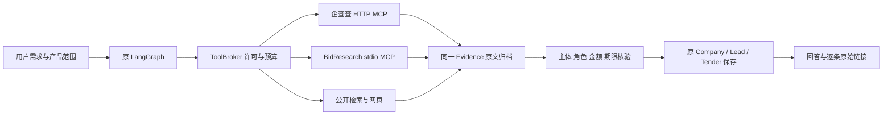

# Agent 的企业与采购 MCP

核验日期：2026-10-13。适用业务：软件开发、企业知识库、AI 应用服务的公开采购买方研究。

本轮企业历史适配与完整现场证据见 [历史公告验收](16-mcp-history-detail.md)。共享工具已升级 0.2.0，应用优先使用绝对 `scripts/run_mcp.py` 入口；四个工具包括独立 `get_tender_detail`。企业历史默认五页，不按近365天删除旧业绩；用户明确近期窗口时，后续补查仍沿用窗口。产品获客继续保留近期/未截止核验。

企业详情额度是单任务上限，共用读取总数。共享详情工具最多发8个含跳转的请求，应用每次保守预留8；例如五页列表和8条详情需约70个请求预留，预算不足时保留已取得记录并报告缺口。新设置默认80，已保存用户设置不自动提高。

## 运行方式

沿用原 LangGraph、ToolBroker、SQLite checkpoint 和事实保存门禁。没有增加第二套 Agent。采购检索优先调用本地 BidResearch；企业查询先确认完整主体，再补企查查工商资料，最后检索公告及其他公开来源。



BidResearch 默认路径是 `D:/Codes/000GithubProject/Result/001_bid_research_tool`。应用固定执行：

```powershell
# 以下命令从外部工具目录运行；应用通过官方 MCP SDK 管理子进程。
.\.venv-runtime\Scripts\python.exe -X utf8 -m bidresearch.mcp_server
```

部署者可用 `CLIENTREACH_BIDRESEARCH_HOME` 指定已安装工具目录。模型不能选择命令、cwd、输出路径或任意服务端工具。依赖保留在外部工具目录，不整体复制到当前项目。

企查查凭据仍只读 `config/apikey.txt`，支持已提供的“企查查：”及其下一行 `mcp key：Bearer …` 格式；不会改写该文件。实际工具名及参数从已核验绑定映射，工具调用前检查服务端目录。不要把密钥填入前端设置、提示词或源码。

## 设置与预算

“设置 → 渠道”提供独立的“企查查授权 MCP”和“公开采购检索”开关。“研究设置”提供对应额度。

| 设置 | 默认值 | 计数方式 |
| --- | --- | --- |
| `qcc_enabled` / `bidresearch_enabled` | 开启 | 还需要凭据或本地工具已安装 |
| `max_qcc_calls` | 4 | 同 Job 实际尝试总数，失败/恢复不清零 |
| `max_bidresearch_calls` | 2 | 同 Job 采购检索尝试总数 |
| `bidresearch_max_requests` | 24 | 同 Job 外部请求预留总额，保守计入失败 |
| `bidresearch_max_details` | 4 | 单次详情上限，同时计入原 `max_reads` |
| `bidresearch_timeout` | 90 秒 | 单次采购工具调用超时 |
| `bidresearch_browser` | 关闭 | 千里马、剑鱼等浏览器来源需显式启用和依赖 |

默认使用公共资源交易平台与必联网。工具支持七站，不表示七站每次都可用或已取得正文；覆盖状态按每站实际结果展示。MCP ID 不进入原 `enabled_channels` 枚举，采购仍服从公开采购渠道许可。

同 Job 同参数的成功或失败调用复用账本，两个并发请求不会重复发送。同 Job 显式恢复才重试暂时失败；所有预留额度累计。跨 Job 不共用应用调用结果，外部工具可以按自身策略复用缓存。已取得 MCP 正文直接进入核验，不再重复抓取同页。

## 信息质量

- 软件 / AI 服务画像要求真实服务对象；机构名中的“人工智能”、工程项目、资产处置、投标软件安装说明、泛称平台建设均不能单独证明软件需求。
- 明确要求“正在采购 / 未截止 / 仍可投标”时，保存前重新检查原文买方、正式响应/投标期限及开放状态。保证金、报名、获取文件期限不能替代投标期限；未知、冲突、已成交或暂停不占当前机会名额。
- 标准采购人信息块直接按原文提取，省去一次模型重写；其余格式仍走原模型和保存门禁。联系方式限定在买方块内，不借代理机构或平台电话。
- 工商字段按实际 JSON 路径及字段语义核验，股东、产品或其他公司的名称/地址不能借作主企业事实；简称和模糊主体需要确认。
- 表格金额必须对应正确数据列；普通金额必须与实际字段标签相邻。候选报价、成交额、预算分别处理，不跨标包求和。
- 完全相同的公告正文可合并转载并保留各来源；不同日期、阶段、项目号或正文保留。一个买方的不同项目并存，不把合法公告差异标成身份冲突。
- 原始 Evidence 保留全文、来源、日期、hash 与工具状态。搜索摘录不算全文，遮挡字段保持未知。遇 robots、登录、验证码或明确拒绝，不换读取器绕过。

推荐请求：

> 我们提供企业知识库、人工智能应用开发和软件开发服务。请在全国公开采购公告中找近30天正在采购这些服务的买方，最多3家。给出具体项目名称、采购单位、预算、投标截止时间、项目编号、需求和原始链接；未知留空，排除资产处置和供应商宣传，合并转载。

## 真实验收记录

所有实测使用 `.codex-tmp` 下独立 UUID 数据库和 DATA；没有写入生产 CRM。

完整 Agent 输入只有上述业务需求，没有客户名称或公告 URL。Job `6a6c417359104e53881fe1473f933923` 实际保存 **1 家**，30 条来源，9 次模型调用，累计执行 **249407 ms**，状态 `partial`。一次模型抽取超时，不能将这个样本称作全站稳定或性能基准。

具体结果：

| 字段 | 已核验原文 |
| --- | --- |
| 买方 | 东丰县职业高级中学 |
| 项目 | 设备采购及实训室建设—教学虚拟仿真软件开发服务 |
| 项目编号 | 采购计划-[2026]-00114号-JLHS202609420 |
| 预算 / 最高限价 | 1504100 元 / 1504100 元 |
| 响应截止 | 2026-10-16 09:30:00，北京时间 |
| 公告买方电话 | 0437-6318701；未验证接通或采购岗位 |
| 来源 | [公共资源交易平台原公告](https://www.ggzy.gov.cn/information/deal/html/a/220000/0201/20261012/00221cd989e6d1dd438cadf95a45bc7ffb25.html) |

详细规格在采购文件中，公开公告没有完整技术规格，不能补写。该结果证明存在公开软件采购公告，不代表已确认订单或已审核投标资格。

最终保存门禁收紧后，另用真实 MCP 结果核验：科大讯飞完整主体工商资料实际保存；软件开发查询得到4条相关公告，其中2条有可读正文；同 Job 重复查询 `reused=true`，`search_tenders.attempts=1`，东丰公告继续通过新的原文期限门禁并保存5个字段。此轮外部工具有缓存命中，不能当作冷启动耗时。其他遮挡/未读公告只是待核验来源。

本地报告分别为：

- `.codex-tmp/agent-mcp-full/081ab4b779f74f02853e2d87929489b4/report.json`：完整真实 Agent。
- `.codex-tmp/agent-mcp-verification/cdd86d7a658e47edb1cc5c8ffed7b6b9/report.json`：最终 MCP、重复调用和实际保存。
- `.codex-tmp/mcp-ui-1440.png`、`mcp-ui-390.png`：隔离 UI 设置保存/刷新与无水平溢出；控制台零错误/警告。

## 代码与验证入口

`mcp_tools.py` 负责共有账本；`bidresearch_mcp.py` 负责采购工具协议和归档；`procurement_accounts.py` 负责原文采购解析；`company_mcp.py` / `qcc_evidence.py` 负责工商补充与路径核验。编排仍在 `agent.py`，业务保存仍在原模块。

专项验证：

```powershell
cd D:\Codes\003Customer-Reach\backend
.\.venv\Scripts\python.exe -X utf8 -m pytest tests/test_qcc_mcp.py tests/test_qcc_tools.py tests/test_qcc_probe.py tests/test_qcc_evidence.py tests/test_company_mcp.py tests/test_bidresearch_mcp.py tests/test_mcp_tools.py tests/test_agent_mcp_architecture.py tests/test_procurement_account_parser.py -q
```

初次广泛回归：684 passed、6 failed、21 errors；6个失败及5个夹具错误依赖缺失的历史归档 JSON（包括灯具样本及比亚迪/海能历史），16个文档夹具错误因 LibreOffice 缺失。另有9个依赖相同历史归档的身份测试未运行。没有伪造资料、删除测试或改为生产库。

排除明确缺失的历史/文档环境项后，最终串行回归 **691 passed、6 deselected，236.67s**。上一轮3个停止/清理时限用例失败，独立23项及随后完整串行组均通过；没有放宽时限断言。报告为 `.codex-tmp/agent-mcp-final-pytest-serial.xml`，完整命令与过程见本轮计划。

前端构建通过；真实 UI 已检查两 MCP 开关、独立额度保存/刷新、合法渠道枚举和1440/390视口。源码编译、提示词快照一致性、真实凭据扫描与 Windows CRLF 规则下的 diff 检查通过。

本轮只落本地代码；生产服务的当前运行状态不能从隔离验收推出。外部站点覆盖及模型超时仍须按实际任务显示缺口。
