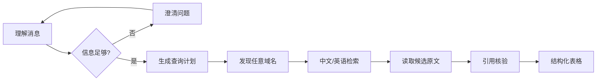

# DealRadar 通用搜索 Agent 设计规格

日期：2026-10-30
状态：设计已确认，等待实施计划
适用版本：DealRadar 当前工作区

## 1. 目标与边界

DealRadar 需要从采购与企业研究工作台扩展为通用搜索 Agent。用户可以用中文或英语描述问题，Agent 先确认不明确的任务，再按可解释的路径检索任意公开网站，读取原文并把可核验结果放入表格。

本次交付包括：

- 新增通用 `search` 任务模式，保留 `find_buyers`、`company` 与普通 `chat`。
- 任务不明确时允许多轮澄清；澄清消息可以使用自然语言。
- 搜索与研究结果只用结构化表格呈现，不生成段落式结论。
- 搜索入口不限制目标网站；搜索引擎只作为发现入口，所有网页检索和读取仍经 LuzCrawl。
- 支持中文、英语和中英混合查询，保留英文标题与原文引用。
- 任务运行期间允许输入补充条件；补充会触发可恢复的重规划，已取得的来源、证据和结果保留。
- 显示阶段、查询、来源、耗时、结果数和失败原因，路径可在任务进行中实时更新。
- 将会话历史移到全局侧栏的“系统设置”下方，工作台保留主对话和产物区。
- 保持浅色石墨视觉：语义色用于状态文字底色和卡片浅背景，卡片边框使用中性细线。

本次不做：

- 不替换 LuzCrawl，不增加 Exa、OpenCLI、Playwright 或 HTTP 直读采集通道。
- 不重写已核验的采购、企业、线索数据模型和评分规则。
- 不修改共享 Luz skill 的规则文件或脚本；交付时只写入经验库和项目 BRIEF。
- 不把未在原文中出现的金额、日期、联系人或能力补成事实。

## 2. 用户可见行为

### 2.1 意图与对话

理解阶段读取当前消息、同一会话最近消息和当前任务的补充条件。计划输出四种模式：

| 模式 | 用途 | 输出 |
| --- | --- | --- |
| `find_buyers` | 描述产品找采购方 | 采购单位表格、线索字段和原文链接 |
| `company` | 查询企业、采购、中标和上下游 | 企业与公告表格 |
| `search` | 通用网页搜索 | 通用搜索结果表格 |
| `chat` | 普通聊天或基于已有结果的追问 | 可流式自然语言 |

如果信息不足以确定搜索目标，计划设置 `needs_clarification=true`，任务进入 `awaiting_input`，Agent 只提出必要问题。用户补充后沿用同一会话和任务上下文。进入搜索或研究结果阶段后，Agent 消息不生成 Markdown 段落；状态卡、路径表、结果表和来源链接仍可显示文字标签。

### 2.2 搜索路径



通用搜索的阶段为：`understand → clarify（可选）→ plan → discover → search → read → verify → table`。采购和企业模式继续使用现有领域阶段，但统一使用同一套状态、路径和结果呈现协议。

### 2.3 执行中补充

运行、排队、等待用户、暂停和部分完成状态下，输入框与附件入口保持可用。用户发送的内容作为当前任务的补充消息保存，不再返回“当前对话还有进行中的任务”。

补充处理顺序：

1. 服务端以 `request_id` 做幂等检查，写入补充消息。
2. Runner 取消当前执行，发出 `replanning` 状态。
3. 任务保留已有 `sources`、`search_candidates`、已核验记录和结果行。
4. 从 `understand` 重新生成计划，计算受影响的阶段并清除这些阶段的完成标记。
5. 从检查点继续，新增查询和来源使用新的状态记录，旧来源不重复读取。
6. 前端显示“重规划中”，完成后更新同一张路径表与结果表。

用户点击停止只暂停任务，不删除已取得的数据；点击继续沿用原有 `/continue` 接口。

## 3. Agent 运行与数据契约

### 3.1 Plan Schema

在现有 `Plan` 上增加：

```text
mode: find_buyers | company | search | chat
needs_clarification: boolean
questions: string[]
language: auto | zh | en | mixed
query: string
result_columns: string[]
```

`keywords`、`company`、`regions`、`days` 和 `exclusions` 对原有领域模式继续生效。模型只负责意图、查询词、语言和需要展示的字段；程序负责来源选择、并发、翻页、超时、轮次、额度和重试边界。

### 3.2 任务状态

`Job.status` 增加 `awaiting_input` 和 `replanning`。SSE 终态包含 `completed`、`partial`、`failed`、`paused`、`awaiting_user`、`awaiting_input`；`replanning` 是可续跑状态，不是终态。

`Job.plan` JSON 保存以下运行状态：

```text
supplements: [{message_id, content, created_at}]
search_queries: [{query, language, source, status, count, elapsed_ms}]
search_candidates: [{title, url, domain, snippet, language, source_id}]
search_results: [{title, url, domain, language, published_on, points, summary,
                  quote, source_id, status}]
stage_history: [{stage, status, started_at, finished_at, elapsed_ms, count, error}]
source_ids: string[]
replan_from: string | null
```

现有采购结果仍使用 `JobCompany`、`Notice`、`Company` 和 `Lead`；通用网页结果先保存在任务计划 JSON 与 `Source` 证据记录中，避免引入一张无法复用的临时业务表。

### 3.3 通用结果行与核验

通用搜索报告返回：

```json
{
  "mode": "search",
  "columns": ["标题", "来源", "语言", "日期", "要点", "原文"],
  "rows": [
    {
      "title": "...",
      "url": "https://example.com/article",
      "domain": "example.com",
      "language": "en",
      "published_on": "2026-10-30",
      "points": ["...", "..."],
      "summary": "...",
      "quote": "原文连续片段",
      "source_id": "...",
      "status": "verified"
    }
  ],
  "path": [],
  "sources": [],
  "problems": []
}
```

每个 `quote` 必须是 LuzCrawl 保存正文中的连续片段；需要展示的日期、要点和摘要只能从该正文抽取。引用、日期或标题无法核验的行不进入最终表格，并在路径表中记录原因。英文内容保留原文，表头和状态标签使用中文。

### 3.4 事件与 API

沿用现有 SSE，并补充以下事件数据：

- `run.queued`、`run.started`、`run.cancelled`、`run.completed`、`run.failed`。
- `stage.started`、`stage.completed`，包含阶段名、标签、耗时、数量和错误。
- `search.route`，包含查询、语言、入口、目标域名、状态、结果数和耗时。
- `result.row`，包含已核验的结果行或行状态变化。
- `message.delta` 只用于 `chat` 或澄清消息。

每个事件包含 `id`、`run_id`、`ts`、`elapsed_ms`；继续支持 `Last-Event-ID`、15 秒心跳、代理禁用缓冲和断线续传。

`POST /api/conversations/{id}/messages` 增加 `request_id`。任务空闲时创建新任务；任务活跃时把消息写为补充并返回 `supplemented: true`，重复的 `request_id` 返回第一次结果，不重复扣除研究次数。`GET /api/jobs/{id}/report` 扩展为返回 `mode`、`columns`、`rows`、`path`、`sources`、`problems` 和质量统计。

## 4. 来源路由与多语言查询

通用搜索使用 LuzCrawl 读取搜索入口页面，过滤入口自身导航、登录页和无效链接，动态记录目标域名。目标网站不需要提前登记；保留 URL 协议校验、页面完整性校验和用户登录/验证交接。

查询计划最多生成一组中文词、一组英文词和必要的混合词。语言为 `auto` 时由模型给出初始判断，程序保留原始查询并按语言标记结果。查询、来源、候选和详情读取都受现有 `max_queries`、`max_reads`、`max_model_calls`、`max_minutes` 限制。

采集错误按现有规则处理：限流不重试、不换入口；登录或验证码进入用户交接；读取失败保留已完成结果并在路径表显示失败原因；模型参数错误返回当前参数、原因和可修改方向。

## 5. 前端设计

### 5.1 全局侧栏与工作台

`App.vue` 的全局侧栏在“系统设置”下方增加会话历史区域，历史按今天、昨天、更早分组，支持新建、当前高亮、运行状态点和移动端抽屉。`Workbench.vue` 删除自身历史栏，主区域保留聊天、过程卡、产物抽屉和输入区。

输入区在任务运行时不禁用；发送按钮提交补充，停止按钮仍位于输入区。输入区辅助文字说明补充会触发重规划且已取得来源会保留。相同任务的多条用户消息只渲染一张过程卡，避免补充后重复显示同一运行过程。

### 5.2 状态与路径卡

状态颜色只使用文字标签浅色底、状态点和过程卡浅背景：

| 状态 | 文字底色 | 卡片背景 |
| --- | --- | --- |
| 排队/暂停 | 中性灰 | 极浅灰 |
| 运行/检索 | 靛蓝浅底 | 冷白蓝 |
| 等待用户/重规划 | 琥珀浅底 | 暖白黄 |
| 完成/核验 | 绿色浅底 | 极浅绿 |
| 部分完成 | 橙色浅底 | 极浅橙 |
| 失败/受限 | 红色浅底 | 极浅红 |

过程卡与表格外框统一使用中性细线，不使用语义色边框。展开步骤显示每一步的文字状态、来源、数量、耗时和失败原因；当前步骤在折叠行实时更新。

### 5.3 表格与采购内容

研究和通用搜索结果按全宽展开；对话文字保持窄列。表格正文 14px、行高 22px，数据行 44–48px，表头居中，长文本左对齐，短值和日期居中。日期列固定宽度并允许完整日期显示。

采购内容按原始分隔符拆成最多三条浅色列点，完整内容放入 `title` 提示；移动端复用同一列点数据。通用搜索结果默认展示标题、来源域名、语言、日期、要点和原文链接，英文标题与引用不翻译、不截断为不可读片段。

### 5.4 输出边界

澄清区和普通聊天区继续使用 Markdown；搜索和研究结果区隐藏段落式助手回答，只显示过程状态、搜索路径表、质量信息、来源和结果表。结果为空时显示空表状态和可继续补充入口，不生成替代性段落总结。

## 6. 测试与验收

### 后端

- Plan 的四种模式、澄清条件、中文/英语查询和补充条件合并。
- 任意域名候选过滤、重复 URL/标题去重、引用核验和失败行排除。
- 活跃任务补充、暂停/重规划/恢复、幂等 `request_id` 和研究次数只扣一次。
- `awaiting_input`、`replanning` 与 SSE 历史事件、断点续传、终态关闭。
- LuzCrawl 登录、验证码、限流和部分失败的状态映射。
- 现有采购、企业、线索和质量测试全部回归。

### 前端

- 运行中输入、附件、补充、停止和继续。
- 过程卡每一步状态文字和底色实时更新，卡片边框保持中性。
- 通用结果只渲染表格，澄清消息可渲染自然语言。
- 会话历史在全局侧栏“系统设置”下方，工作台不重复显示历史栏。
- 日期列完整、采购内容最多三条列点、英文标题与来源可读。
- 1440×900 和 390×844 无横向溢出，控制台无错误。

### 交付前检查

- `backend/.venv/Scripts/python.exe -m pytest tests -q`
- `npm run build`
- `npm test`
- `npm run e2e`
- `git diff --check`
- Luz-System、Luz-Design、Luz-Dev、Luz-Writing、Luz-Crawl 规则卡检查与经验沉淀。

## 7. 风险与回退

- 搜索入口页面结构变化：路径表标记来源失败，保留其他来源结果；不绕过 LuzCrawl。
- 英语页面正文不足：保留候选行但标记未核验，不进入事实字段；用户可补充来源或放宽查询。
- 运行中补充与当前模型调用并发：先取消当前 Runner，再从保存状态重启；所有写入使用幂等请求。
- 现有 SQLite 数据没有新表依赖；新增字段通过 `init_db` 的兼容性补列逻辑处理。旧任务按旧模式继续运行，未完成任务可暂停后重新规划。
- 发现不可恢复错误时保留部分结果、请求编号和下一步，允许继续或重新提交。

## 8. 规则与研究记录

本设计采用的规则：

- Luz-System `agent-ui`、`agent-runtime-ui`、`interaction`：状态、路径、SSE、补充、断点、错误和闭环。
- Luz-System `system-design`：先调研组件规范，表格与状态的可追溯交互契约。
- Luz-Design `interface-visual`、`palette`：浅色石墨、状态文字底色、卡片浅背景、中性边框、日期与表格密度。
- Luz-Dev `agent-service`、`agent-runtime`：模型决策、程序执行、上限、幂等、断点、事件和失败恢复。
- Luz-Writing `general`、`fact-check`：澄清与结果边界、原文引用和未知信息不补造。
- Luz-Crawl：唯一采集通道、搜索入口发现、登录/验证码交接、限流不重试。

本次经验只沉淀到各技能经验库和项目 BRIEF，不修改共享技能规则或脚本。
